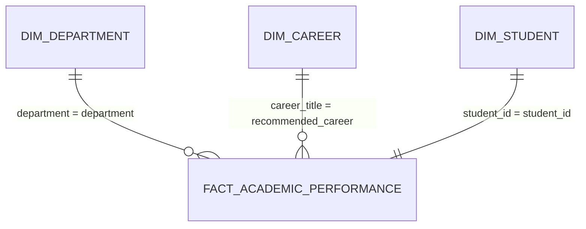

# 📊 Power BI Implementation Guide: Academic Performance & Career Planning System

This guide outlines how to build an enterprise-grade **Academic Performance and AI Career Planning Dashboard** in **Microsoft Power BI Desktop**.

---

## 📁 Included Resources & Data Files

All project files and pre-processed datasets are located in:
`C:\Users\Nisha Patil\.gemini\antigravity\scratch\academic_career_system\powerbi\`

| File | Purpose |
| :--- | :--- |
| **`datasets/PowerBI_Academic_Career_Unified.csv`** | Ready-to-use primary flat dataset (Student demographics, grades, ML predictions, risk tiers, career recommendations). |
| **`datasets/Dim_Career.csv`** | Dimension table for career pathways, target GPA, average salary, and required core skills. |
| **`datasets/Dim_Department.csv`** | Dimension table with department names, faculty heads, and attendance targets. |
| **`PowerBI_DAX_Measures.dax`** | 15+ production DAX formulas for KPIs, percentages, risk thresholds, and conditional colors. |
| **`PowerBI_Python_Visual.py`** | Script to embed live Seaborn/Matplotlib ML regression plots directly in Power BI. |

---

## 🚀 Step 1: Import Data into Power BI Desktop

1. Open **Power BI Desktop**.
2. Click **Get Data** (Home Ribbon) -> **Text/CSV**.
3. Select `PowerBI_Academic_Career_Unified.csv` from:
   `C:\Users\Nisha Patil\.gemini\antigravity\scratch\academic_career_system\powerbi\datasets\PowerBI_Academic_Career_Unified.csv`
4. In the preview window, verify the column types:
   - `attendance_rate`, `study_hours_per_week`, `prior_gpa`, `ml_predicted_gpa`, `career_match_score` should be **Decimal Number**.
   - `past_failures`, `stress_level` should be **Whole Number**.
5. Click **Load**.
*(Optional: If building a Star Schema, also import `Dim_Career.csv` and `Dim_Department.csv` and link them via `department` and `career_title` in the Model View).*

---

## 📐 Step 2: Power BI Data Model (Star Schema)

In the **Model View** (left navigation tab), establish the following 1-to-Many relationships:



---

## 🧮 Step 3: Add Key DAX Measures

In the **Report View**, click **Modeling** -> **New Measure** and paste the formulas from `PowerBI_DAX_Measures.dax`:

1. **Total Students:**
   ```dax
   Total Students = COUNTROWS('PowerBI_Academic_Career_Unified')
   ```
2. **At-Risk Percentage:**
   ```dax
   At-Risk Percentage = 
   DIVIDE(
       CALCULATE(COUNTROWS('PowerBI_Academic_Career_Unified'), 'PowerBI_Academic_Career_Unified'[ml_predicted_risk] = "High Risk"),
       [Total Students],
       0
   )
   ```
3. **Predicted vs. Prior GPA Delta:**
   ```dax
   GPA Variance Delta = AVERAGE('PowerBI_Academic_Career_Unified'[ml_predicted_gpa]) - AVERAGE('PowerBI_Academic_Career_Unified'[prior_gpa])
   ```
4. **Percentage Career Ready (Score >= 85%):**
   ```dax
   Percentage Career Ready = 
   DIVIDE(
       CALCULATE(COUNTROWS('PowerBI_Academic_Career_Unified'), 'PowerBI_Academic_Career_Unified'[career_match_score] >= 85),
       [Total Students],
       0
   )
   ```

---

## 🖥️ Step 4: Design the 3-Page Dashboard Layout

### 📌 Page 1: Institutional Academic Performance Scorecard
* **Top Header / Slicers:**
  - Slicer by `department` (Tile or Dropdown).
  - Slicer by `ml_predicted_risk` (`Low Risk`, `Moderate Risk`, `High Risk`).
* **KPI Scorecard Cards (Top Row):**
  - **Card 1:** `Total Students` (Formatted as integer).
  - **Card 2:** `Average Predicted GPA` (Target: 3.20).
  - **Card 3:** `At-Risk Percentage` (Color: Red `#EF4444` if > 15%).
  - **Card 4:** `Avg Attendance Rate` (Goal: >= 80%).
* **Main Visuals (Middle & Bottom):**
  - **Clustered Column Chart:** Department on X-axis, `Avg Prior GPA` and `Avg Predicted Final GPA` on Y-axis.
  - **Donut Chart:** `ml_predicted_risk` on Legend, `Total Students` on Values (Colors: Green, Amber, Red).
  - **Scatter Plot:** X-axis = `study_hours_per_week`, Y-axis = `ml_predicted_gpa`, Legend = `ml_predicted_risk`.

---

### 📌 Page 2: Early Warning & Risk Diagnostics (AI Powered)
* **Power BI Key Influencers Visual (Native AI Visual):**
  - **Analyze:** `ml_predicted_risk` (Set to "High Risk").
  - **Explain By:** `attendance_rate`, `study_hours_per_week`, `midterm_score`, `past_failures`, `stress_level`.
  - *Outcome:* Automatically reveals which factors increase the probability of high risk the most (e.g., "Attendance rate < 60% increases risk by 3.8x").
* **Power BI Decomposition Tree Visual:**
  - **Analyze:** `High Risk Student Count`
  - **Explain by:** `department` -> `stress_level` -> `past_failures`.
* **Actionable Student Intervention Table:**
  - Columns: `student_id`, `name`, `department`, `attendance_rate`, `midterm_score`, `past_failures`, `ml_predicted_gpa`, `ml_predicted_risk`.
  - Conditional formatting on `attendance_rate` (Red data bar if < 70%).

---

### 📌 Page 3: AI Career Readiness & Skill Gap Matrix
* **Treemap / Bar Chart:**
  - Category = `recommended_career`, Values = `Total Students`.
  - Tooltips: `Avg Career Match Score`.
* **Gauge Visual:**
  - Value: `Avg Career Match Score` (Target = 85%).
* **Matrix / Table of Skill Gaps:**
  - Rows: `recommended_career`.
  - Columns: `department`.
  - Values: `Avg Career Match Score`.
  - Sub-detail: `key_missing_skills` (Lists what students must learn to be placement-ready).

---

## 🐍 Step 5: (Optional) Embed Custom Python AI Visuals in Power BI

Power BI Desktop supports running Python visuals directly:
1. In Power BI, go to **File** -> **Options and settings** -> **Options** -> **Python scripting** and ensure your Python home directory is detected.
2. In the **Visualizations** pane, click the **Python Visual (`Py`)** icon.
3. Drag `study_hours_per_week`, `ml_predicted_gpa`, `ml_predicted_risk`, and `attendance_rate` into **Values**.
4. Paste the script from [PowerBI_Python_Visual.py](file:///C:/Users/Nisha%20Patil/.gemini/antigravity/scratch/academic_career_system/powerbi/PowerBI_Python_Visual.py) into the editor and click **Run**.
